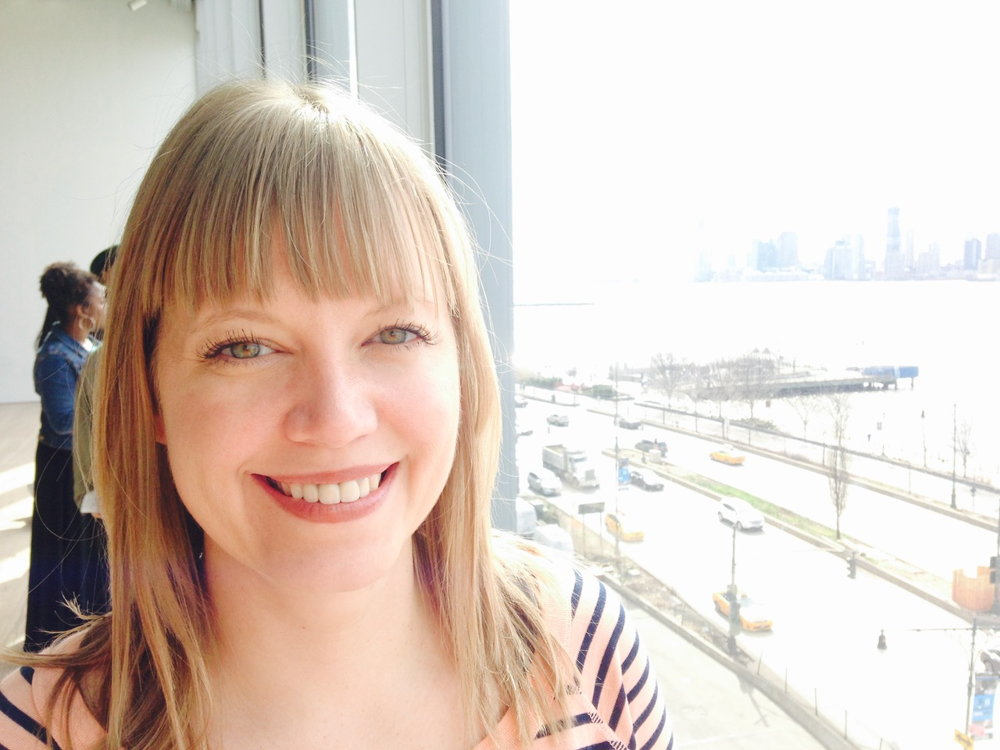

I am an <a href="https://www.ipac.caltech.edu/science/staff/jennifer-sobeck">Associate Scientist</a> at <a href="https://www.ipac.caltech.edu/">Caltech/IPAC</a> and the Lead Systems Scientist for the <a href="https://www.ipac.caltech.edu/project/roman">Nancy Grace Roman Space Telescope</a> Science Support Center (SSC) at IPAC. I also oversee the development team for the Microlensing Science Operations System (MSOS), the pipeline that will process data from Roman's core Galactic Bulge Time Domain Survey (GBTDS). I work with teams at NASA Goddard and STScI to help prepare the mission for the data volumes of its wide-field surveys.

I am a stellar spectroscopist with a background in atomic and molecular physics. My research focuses on the chemical and kinematic characterization of stellar populations in the Milky Way and the Local Group.

Before joining IPAC, I was System Scientist for the Maunakea Spectroscopic Explorer at the Canada-France-Hawaii Telescope. Before that, I was SDSS-IV Project Manager for APOGEE-2 and Las Campanas Observatory operations, based at the University of Washington and, earlier, the University of Virginia. I received my Ph.D. in Physics from the University of Texas at Austin in 2007, then held postdoctoral positions at ESO, the University of Chicago (JINA and KICP), and the Observatoire de la C&ocirc;te d'Azur.

I am the primary developer of <a href="https://github.com/jsobeck/MOOG_SCAT">MOOG_SCAT</a>, a radiative transfer code that includes coherent, isotropic scattering.
